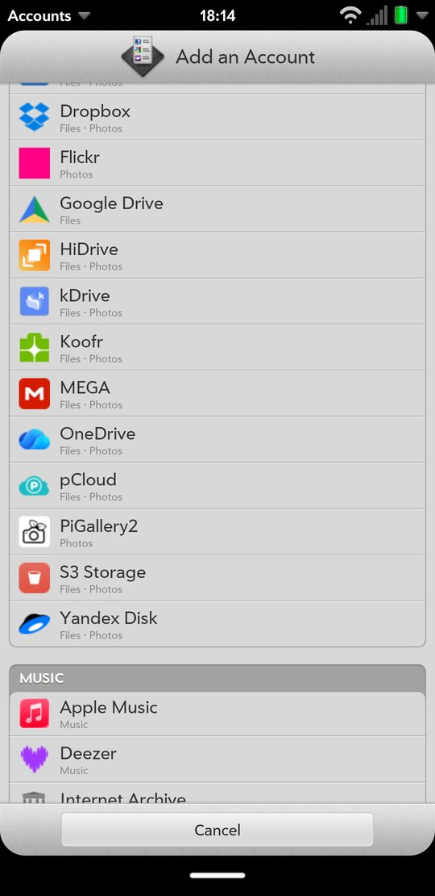
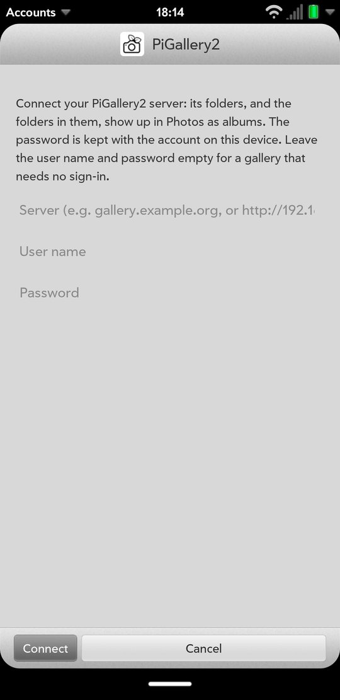
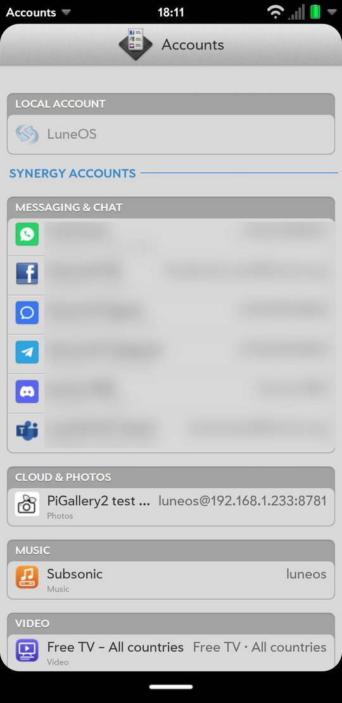
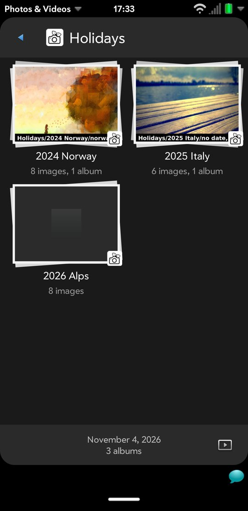

# PiGallery2 connector

A **photo-only** Synergy connector for [PiGallery2](https://github.com/bpatrik/pigallery2), the
self-hosted, folder-based photo gallery: the gallery's folders show up in the Photos app as
albums, **the folders in them as their sub-albums**, and their photos come down into it. There
is no OAuth and nothing to register: each account brings its own server, user name and
password. No upload, no documents/files role.

**Read-only: nothing is uploaded.** `PHOTO.UPLOAD` is only the name of the account capability the
Photos service looks for to list an account as a photo source (PhotoPrism, Immich, SmugMug and
Flickr carry it too); this connector has no upload method.

## Status and limitations

> **Works on a device; not in the LuneOS image yet.** Checked 2026-11-04 against PiGallery2 3.5.2
> (the `bpatrik/pigallery2` Docker image), with sign-in and with sign-in turned off: a wrong
> password, a gallery that wants a sign-in, nested folders, a folder with only sub-folders, an
> empty one, a TIFF and a video; through com.palm.service.photos' sync (in-memory db8, its real
> download) to the albums' `parentId`s and the files, originals byte for byte; and on a Pixel 3a
> (sargo): signed in from Accounts, synced (58 folders, four deep) and browsed in Photos.

- **Sub-albums need the photos service and the Photos app that know them**: `parentAid` in
  listAlbums is new in com.palm.service.photos (app-services), and the Photos app shows an
  album's sub-albums inside it. With an older service every folder is a top-level album.
- **The password is kept with the account** (Accounts' credential store, as WebDAV's is):
  PiGallery2 has no tokens or app passwords, only a session cookie, which ends after a week of
  no use. A gallery with sign-in turned off keeps nothing secret.
- **The photo links need the session**, which listPhotos hands to the Photos service as a
  `Cookie` header for that listing's downloads. The Photos service sends it with those
  downloads only, follows no redirect with it and keeps it nowhere. **Over plain `http://` the
  password and the session cross the network in the clear**: fine on a home LAN, not across
  the internet. Use https there.
- **Showing WebP needs Qt's WebP image plugin** (`qtimageformats-plugins`): HEIC, AVIF, TIFF,
  SVG and the like come over as PiGallery2's WebP thumbnails, and an image without that plugin
  shows them blank.
- **Self-signed certificates are refused** (node's own TLS checks); a server behind one needs a
  certificate the device trusts, or plain http on the LAN.
- **HEIC, AVIF, TIFF, RAW, SVG and other non-web formats come over as PiGallery2's 1080 px
  thumbnail** (WebP by default), not the original. JPEG, PNG, GIF, WebP and BMP come over as the
  original, byte for byte. A gallery without 1080 among its thumbnail sizes gives its smallest.
- **Photos only, read-only**: videos are left out (by their metadata, or by name); nothing is
  uploaded. A folder with no photos in it or below it is no album.
- **Every folder** is read, 4 at a time, up to 20000 (past that the rest are left out, and logged). The walk is a job (`_cloudcore/node/jobs.js`): the Photos service asks after it until it is done, so a large gallery need not be walked within one call.
- **Only folders**: PiGallery2's saved-search albums, faces and sharing links are not used.

## Screenshots

| | | | |
|:---:|:---:|:---:|:---:|
|  |  |  |  |
| Add an account | The sign-in | The account (the others blurred) | A folder's folders in Photos |

Taken on a Pixel 3a against a test gallery.

## Components

| Path | What it is |
|---|---|
| `service/com.palm.service.pigallery2/` | The node service on `_cloudcore/node` (node 22): `service.js` (the methods), `login.js` (the account validator), `adapter.js` (the API, sessions, credentials), `photos.js` (listAlbums/listPhotos), `config.js`. |
| `apps/com.palm.app.pigallery2-auth/` | customUI sign-in form (server address, user name, password), as cloud/photoprism's; the user name and password may both be empty for an open gallery. |
| `account/com.palm.pigallery2/` | Synergy account template — **PHOTO.UPLOAD capability only**. The icons are PiGallery2's own camera with leaves (its default `svgIcon`, MIT), black on a white tile at our corner radius. |
| `files/sysbus/` | The service's LS2 files. |

## Service methods

| Method | Caller | Purpose |
|---|---|---|
| `login` | sign-in app (account validator) | `{ server, username, password }`: settles the address, asks `/pgapi/user/me` without a session (a gallery that wants a sign-in answers 401, an open one the user), signs in with `/pgapi/user/login` unless it is open, lists the top folder; returns `credentials.common` = `{ server, username, password, open, name }`, `<user>@<host>` (or the host) as the username. |
| `checkCredentials` | accounts | Signs in with the stored user name and password and asks `/pgapi/user/me`. |
| `listAlbums` | Photos service | Walks `GET /pgapi/gallery/content/<folder>` from the top: `{ aid: <folder path>, name, size: { images }, parentAid }`; the top folder is the album `"/"` ("Gallery") when it has photos itself. |
| `listPhotos` | Photos service | A folder's photos (`pid` is the photo's path) and `headers: { Cookie }`. |

A folder that cannot be read fails listAlbums or listPhotos, so the Photos service keeps what it
has instead of taking the folder as emptied; a folder that is gone (404) is just not there.

## Sessions

PiGallery2 keeps its session in a signed cookie pair (`pigallery2-session` and its `.sig`). The
service keeps one per server and user for an hour, signs in again after that or when a call is
refused with 401 (once per call), and never logs it.

## The server address

`gallery.example.org`, `https://gallery.example.org/gallery/Holidays` and
`http://192.168.1.5/pgapi` are all taken: no scheme means https, a pasted page or API address
is cut back at the app's own paths (`/gallery`, `/search`, `/pgapi`, ...), a sub-path
(`https://example.org/photos`) is kept. A redirect of the first request (http → https, say) to
the same host is followed **once, at sign-in, before anything secret is sent**; the address it
leads to is stored. Afterwards requests follow no redirect, since fetch would carry the session
along to wherever one points.

## Errors

PiGallery2's own `message` makes the `errorText`; no reply body, and never the password or the
session. The sign-in errors have their own codes: `PIGALLERY2_UNREACHABLE` (with a hint when an
https address meets a plain-http server), `PIGALLERY2_NOT_FOUND`, `PIGALLERY2_SIGN_IN_NEEDED`,
`PIGALLERY2_AUTH_FAILED`, `PIGALLERY2_NO_SESSION` and `PIGALLERY2_NO_ACCESS`. The sign-in app
shows the service's error and logs only how the sign-in ended, not its result (which holds the
password).

## Tests

`tests/unit/pigallery2.test.js`: every method over a stand-in bus and fetch, with the reply
shapes a PiGallery2 3.5.2 server gave: both kinds of gallery, the redirect handling, the folder
tree (empty folders, folders gone mid-walk, repeats, the cap, how many are read at a time),
sessions kept, aged and renewed, originals against thumbnails, videos left out, the error cases.
Every request of every method also fails in turn.
